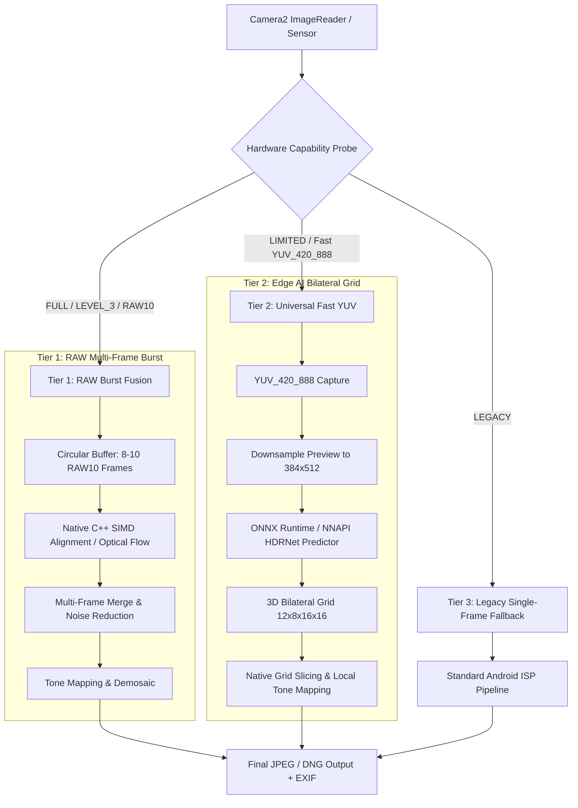

# LumaCore Camera 📸

> **Dual-Engine Computational Photography & AI Burst Fusion Engine for Android**  
> Powered by Camera2, Native C++20 (NDK/GLESv3), ONNX Runtime (NNAPI), and Jetpack Compose.

---

## 🌟 Architectural Overview

LumaCore Camera is engineered as a high-performance computational photography application for Android devices. It dynamically probes camera hardware capabilities and routes incoming sensor frames through a tiered processing pipeline:



---

## ⚡ Hardware Tier Specifications

| Hardware Tier | Required Capabilities | Capture Strategy | Computational Pipeline | Target Latency |
| :--- | :--- | :--- | :--- | :--- |
| **Tier 1: RAW Burst** | `INFO_SUPPORTED_HARDWARE_LEVEL_FULL` or `LEVEL_3`, `REQUEST_AVAILABLE_CAPABILITIES_RAW` | 8–10 RAW10 burst frames with zero shutter lag (ZSL) | Native C++20 SIMD tile alignment, temporal noise fusion, demosaicing | `< 800ms` total fusion |
| **Tier 2: Universal YUV** | `INFO_SUPPORTED_HARDWARE_LEVEL_LIMITED` or `FULL` | Single or 3-bracket YUV_420_888 stream | ONNX Runtime NNAPI bilateral grid inference + local affine slicing | `< 45ms` neural inference |
| **Tier 3: Legacy Fallback** | `INFO_SUPPORTED_HARDWARE_LEVEL_LEGACY` | Standard single-frame JPEG capture | Android hardware ISP direct rendering | `< 20ms` |

---

## 📁 Repository Structure

```
├── .agents/                        # HyperFlash agent state & reliability contract
├── app/
│   ├── src/
│   │   ├── main/
│   │   │   ├── AndroidManifest.xml # Camera, audio permissions & activity declarations
│   │   │   ├── assets/models/      # Neural network assets (HDRNet bilateral grid ONNX)
│   │   │   ├── cpp/                # Native C++20 engine
│   │   │   │   ├── CMakeLists.txt  # CMake configuration (C++20, liblog, libandroid, GLESv3)
│   │   │   │   ├── lumacore_homography.hpp # 3x3 projective matrix math & gyro calibration
│   │   │   │   ├── lumacore_homography.cpp
│   │   │   │   ├── lumacore_pyramid.hpp    # 3-level Gaussian pyramid & L1 block matching
│   │   │   │   ├── lumacore_pyramid.cpp
│   │   │   │   ├── lumacore_merge.hpp      # Shot-noise modeled ghost-rejection temporal merge
│   │   │   │   ├── lumacore_merge.cpp
│   │   │   │   ├── test_burst_align.cpp    # Native unit test suite
│   │   │   │   └── lumacore_native.cpp     # NativeEngine & JNI entry points
│   │   │   ├── java/com/lumacore/camera/
│   │   │   │   ├── MainActivity.kt # Edge-to-edge root activity & permission launcher
│   │   │   │   ├── core/
│   │   │   │   │   ├── buffer/
│   │   │   │   │   │   └── BoundedImageRingBuffer.kt # Strict 3-slot bounded ring buffer with drop-oldest policy & atomic lock
│   │   │   │   │   ├── engine/
│   │   │   │   │   │   └── Camera2CaptureEngine.kt   # Camera2 session lifecycle, preview, metering & burst engine
│   │   │   │   │   ├── hardware/
│   │   │   │   │   │   └── HardwareCapabilityProber.kt # CameraCharacteristics probe, tier classification, binned 12MP sizing
│   │   │   │   │   ├── model/
│   │   │   │   │   │   └── CameraEnums.kt # Enums: FlashMode, HdrMode, TimerSetting, AspectRatio, CaptureMode, HardwareTier, LensFacing
│   │   │   │   │   ├── nativebridge/
│   │   │   │   │   │   └── NativePipeline.kt # JNI connector to lumacore_native
│   │   │   │   │   ├── sensor/
│   │   │   │   │   │   └── GyroscopeSampler.kt # High-frequency gyro integration between frame timestamps
│   │   │   │   │   ├── storage/
│   │   │   │   │   │   └── MediaSaver.kt # Scoped MediaStore DCIM/LumaCore saver with complete EXIF tags
│   │   │   │   │   └── strategy/
│   │   │   │   │       └── CaptureModeStrategy.kt # PhotoStandard, NightBurst, ActionAntiBlur, SuperResZoom, Video strategies
│   │   │   │   └── ui/
│   │   │   │       ├── CameraScreen.kt      # Root viewfinder & layout scaffold with SurfaceView integration
│   │   │   │       ├── CameraUiState.kt     # Immutable UI state data class
│   │   │   │       ├── CameraViewModel.kt   # State manager & gesture/capture controller wired to engine
│   │   │   │       ├── components/
│   │   │   │       │   ├── TopControlBar.kt        # Flash, HDR, Timer, Ratio & Settings toggles
│   │   │   │       │   ├── ViewfinderControls.kt   # Tap-to-focus reticle, EV sun slider, zoom pills, 3x3 grid
│   │   │   │       │   ├── BottomControlDeck.kt    # Mode carousel, tactile shutter with fusion ring, lens switch
│   │   │   │       │   └── SettingsBottomSheet.kt  # Hardware tier probing HUD & engine preferences
│   │   │   │       └── theme/
│   │   │   │           ├── Color.kt  # OLED black, translucent pills, vibrant gold accent tokens
│   │   │   │           ├── Theme.kt  # Dark camera theme & edge-to-edge system bars
│   │   │   │           └── Type.kt   # Clean camera typography
│   │   │   └── res/                  # Android drawables, icons, strings, colors, themes
│   │   └── build.gradle.kts          # App-level build config with NDK, C++ CMake, and Compose
├── gradle/
│   └── libs.versions.toml            # Centralized version catalog
├── ml/
│   └── export_hdrnet_onnx.py         # PyTorch / ONNX exporter for HDRNet bilateral grid model
├── build.gradle.kts                  # Root build script
├── settings.gradle.kts               # Plugin & dependency repositories
├── gradle.properties                 # JVM arguments & AndroidX flags
└── README.md                         # Architecture & documentation
```

---

## 🚀 Milestone Roadmap

- [x] **Milestone 1: Project Scaffolding & Stock Camera UI Shell**
  - Project build infrastructure (AGP 9.0.1, Kotlin 2.2.10, NDK C++20, ONNX Runtime).
  - Modern Stock Camera UI in Jetpack Compose:
    - Top control bar (Flash, HDR, Timer, Aspect ratio, Settings).
    - Viewfinder with tap-to-focus animated reticle, EV sun slider, pinch-to-zoom, and rule-of-thirds grid.
    - Bottom control deck with horizontal mode carousel (`NIGHT`, `PHOTO`, `ACTION`, `ZOOM+`, `VIDEO`), gallery button, tactile shutter button with animated outer ring indicator for burst fusion progress, and flip camera button.
    - Modal settings bottom sheet displaying hardware tier status and real-time telemetry HUD toggle.
  - Native C++ engine stub (`lumacore_native`) with JNI lifecycle.
  - Neural model export script (`ml/export_hdrnet_onnx.py`).

- [x] **Milestone 2: Camera2 Hardware Probing & Zero-Shutter-Lag Pipeline**
  - `HardwareCapabilityProber`: Inspects `CameraCharacteristics` (Hardware level 3/FULL/LIMITED/LEGACY, RAW capabilities) and maps to structured `HardwareProfile`.
  - Resolution selector: Selects optimal binned ~12MP resolution (`targetPixels = 12_000_000`, e.g., 4000x3000, 4032x3024) instead of unbinned 50MP/64MP/108MP buffers.
  - `BoundedImageRingBuffer`: Strict 3-slot bounded image buffer with Drop-Oldest eviction and immediate hardware buffer recycling (`image.close()`), plus atomic shutter lock preventing overlapping captures.
  - `CaptureModeStrategy` hierarchy: `PhotoStandardModeStrategy` (with Tier 2 edge/noise bypass), `NightBurstModeStrategy` (8 frames AE bracketing), `ActionAntiBlurModeStrategy` (6 frames high shutter speed bias), `SuperResZoomModeStrategy` (4 frames sub-pixel sampling), and `VideoModePlaceholderStrategy`.
  - `Camera2CaptureEngine`: HandlerThread lifecycle, repeating preview request, tap-to-focus metering calculation, zoom ratio with Android 11+ `CONTROL_ZOOM_RATIO` and Android 10 `SCALER_CROP_REGION` fallback, EV compensation, and atomic burst capture.
  - `MediaSaver`: Persistent scoped MediaStore saving to `DCIM/LumaCore` with EXIF tags (Make, Model, Software, Orientation, ISO, ExposureTime).
  - UI integration: `SurfaceView` embedded in Compose viewfinder, `CameraViewModel` controlling camera lifecycle, permission handling, and capture callbacks.

- [x] **Milestone 3: C++20 / NDK Gyro-Assisted Pyramid Burst Alignment & Temporal Merging**
  - `lumacore_homography`: Projective 3x3 homography matrix algebra, analytical cofactor matrix inverse, and gyro rotational homography $H = K R K^{-1}$ with $< 0.2\text{ms}$ latency.
  - `lumacore_pyramid`: 3-level Gaussian downsampled luma pyramid with coarse-to-fine L1 block matching, parabolic sub-pixel refinement, and regularized 8-DOF homography solver.
  - `lumacore_merge`: Shot-noise variance modeled temporal frame accumulation ($\sigma^2 = \max(1.0, a I_{ref} + b)$), $4\sigma$ ghost-motion rejection, and multi-plane YUV chroma accumulation.
  - `test_burst_align`: Native unit tests verifying identity transforms, matrix inversion, gyro calibration, synthetic translation recovery ($dx=3, dy=2$), and moving-box ghost rejection.
  - `GyroscopeSampler`: High-frequency (`SENSOR_DELAY_FASTEST`) background sensor sampling with trapezoidal integration between frame exposure timestamps.
  - `Camera2CaptureEngine` & `NativePipeline`: End-to-end wiring of multi-frame burst fusion with bounded buffers and scoped MediaStore JPEG persistence.

- [ ] **Milestone 4: Edge AI HDRNet Bilateral Grid Inference**
  - ONNX Runtime integration with NNAPI execution provider.
  - Downsampled guide frame inference yielding 3D bilateral affine coefficients.
  - Fast C++ / OpenGL ES 3.0 slice-and-apply shader for real-time tone mapping.

- [ ] **Milestone 5: Production Polish, EXIF & Telemetry**
  - JPEG / DNG output serialization with full metadata and EXIF tag preservation.
  - Real-time on-screen telemetry HUD (alignment latency, NNAPI inference time, peak memory footprint).
  - End-to-end device testing and edge-to-edge visual polish.

---

## 🛠️ Build & Development Requirements

- **Android Studio**: Ladybug (2024.2.1) or newer
- **JDK**: Version 17
- **Android SDK**: Compile SDK 36, Target SDK 36, Min SDK 29 (Android 10+)
- **Android NDK**: Version 26+ (CMake 3.22.1)
- **Python (Optional for Model Re-export)**: Python 3.9+ with `torch` or `onnx`

```bash
# Export or regenerate the bilateral grid ONNX model
python ml/export_hdrnet_onnx.py

# Build debug APK
./gradlew assembleDebug
```
